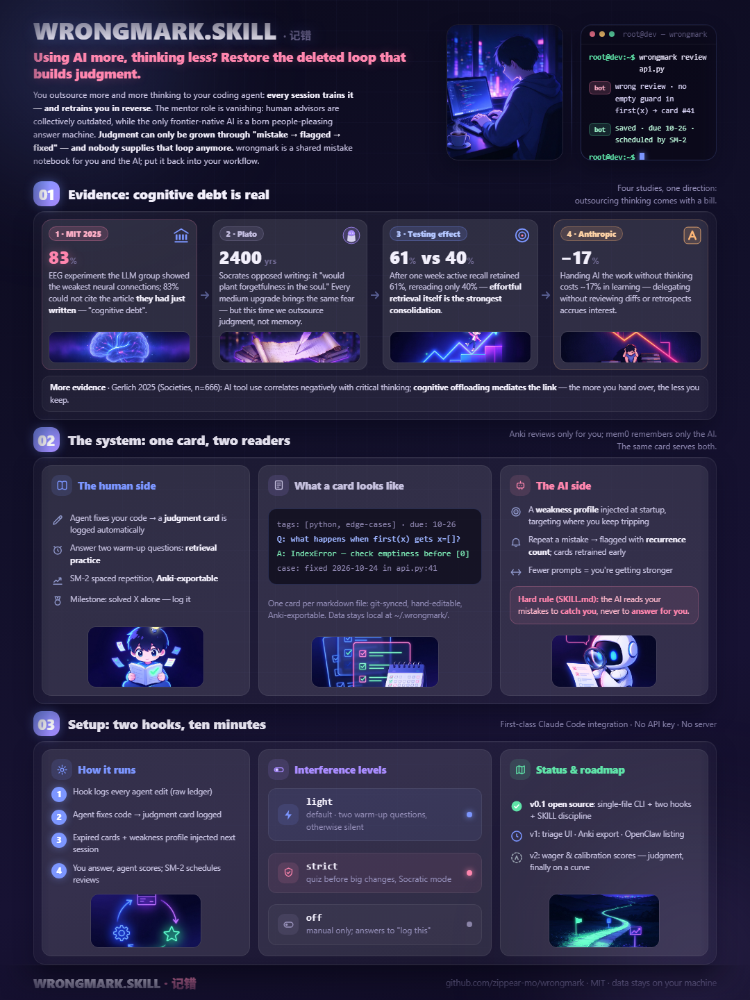
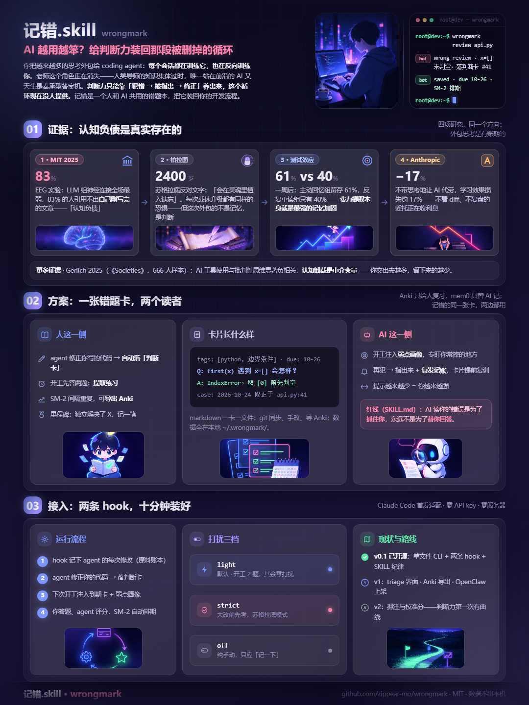

# wrongmark · 记错

**An error notebook shared by you and your AI coding agent** · **一个你和 AI 共用的错题本**

<details open>
<summary><b>🇬🇧 English</b> <sub>click to fold</sub></summary>

<p align="center">
  <a href="docs/cards/poster-en@2x.png" title="view full resolution"></a>
</p>

> An error notebook shared by you and your AI coding agent — it logs your mistakes, quizzes you before work, and remembers your weak spots so the coach never forgets.

You delegate more and more thinking to your coding agent. Every session trains the agent — and de-trains **you**. See [docs/PHILOSOPHY.md](docs/PHILOSOPHY.md) for the full argument: a 2400-year-old warning, what the evidence says, and the two principles wrongmark is built on. The short version: MIT's ["cognitive debt"](https://www.media.mit.edu/publications/your-brain-on-chatgpt) EEG study, [Gerlich 2025](https://www.mdpi.com/2075-2298/15/1/6), and Anthropic's ~17% learning-loss finding all point the same way — and judgment grows only through *mistake → corrected → revised*, a loop nobody provides anymore. **wrongmark wires it back in.**

```
you write a function with an empty-input trap
  -> agent fixes it and drops a "judgment card"      (notebook grows by itself)
  -> next session, a hook injects: "2 cards due first" (retrieval practice)
  -> agent also gets your weak-spot profile, watching where you fall (coach mode)
  -> repeat mistakes get logged -> related cards return sooner  (loop tightens)
```

**One card, two readers.** Anki only reviews *you*; mem0 only remembers *for* the AI. The same markdown card is your spaced-repetition curriculum **and** the agent's watchlist — the AI reads your errors to *catch* you, never to answer *for* you (enforced in [skill/SKILL.md](skill/SKILL.md)).

## Install (Claude Code)

```bash
git clone https://github.com/zippear-mo/wrongmark.git ~/wrongmark
python ~/wrongmark/wrongmark.py doctor   # self-check, creates ~/.wrongmark/
```

Add hooks to `~/.claude/settings.json` (adjust paths):

```json
{
  "hooks": {
    "PostToolUse": [
      { "matcher": "Edit|Write|MultiEdit",
        "hooks": [{ "type": "command", "command": "python ~/wrongmark/hooks/post_tool_use.py" }] }
    ],
    "UserPromptSubmit": [
      { "hooks": [{ "type": "command", "command": "python ~/wrongmark/hooks/user_prompt_submit.py" }] }
    ]
  }
}
```

Then drop [skill/SKILL.md](skill/SKILL.md) into your agent's skill directory. Done — no API keys, no server, nothing leaves your machine.

## Commands

| command | what it does |
|---|---|
| `wrongmark add --stdin` | drop a card (the agent does this when it corrects you) |
| `wrongmark due` | today's due cards |
| `wrongmark review <id> <again\|hard\|good\|easy>` | grade a recall, SM-2 reschedules |
| `wrongmark miss <tag>` | log a repeat mistake; related cards come back sooner |
| `wrongmark milestone "…"` | record growth ("solved X unaided") |
| `wrongmark profile` / `report` | weak-spot profile / weekly stats |
| `wrongmark raw --tail` | raw ledger of every agent edit (append-only) |
| `wrongmark doctor` | self-check |

## Friction modes

`"strength"` in `~/.wrongmark/config.json`: `light` (default, 2 cards at session start) · `strict` (quiz before big changes) · `off` (manual only). Annoyance kills habit tools — you own the dial.

## Design choices

- **Markdown cards, one file per card** — git-syncable, human-editable, Anki-export ready. No daemon, no ports; hooks talk to the CLI purely through the filesystem — fail-open, <50 ms, zero network.
- **Two-tier store** — a raw append-only ledger (everything the agent edits) vs. curated cards (the curriculum). Capture liberally, promote deliberately.
- **Extraction runs in the host agent's own context** — no extra LLM key, no cost.
- **SM-2 today**; FSRS later is a one-function swap.

## Roadmap

- [ ] v1: triage UI, weekly charts, Anki export, OpenClaw skill-market listing
- [ ] v2: prediction bets + calibration score, Cursor/Codex adapters, FSRS
- [ ] the far goal: your calibration curve trending up while the agent's hints trend down — dependence, measurably paid off

## License

MIT. Your data never leaves your machine.


</details>

<details>
<summary><b>🇨🇳 简体中文</b> <sub>点击展开</sub></summary>

<p align="center">
  <a href="docs/cards/poster-cn@2x.png" title="点击查看高清"></a>
</p>

> 人和 AI 共用的错题本——它记下你被 agent 修正的每个坑，开工前先考你两题，并记得你的弱点专盯不放。

你把越来越多的思考外包给了 coding agent。每个会话都在训练 agent——**同时也在反向训练你：变笨**。完整论证见 [docs/PHILOSOPHY.md](docs/PHILOSOPHY.md)（英文）：一个 2400 年前的警告、证据说了什么、以及记错赖以成立的两条原则。短版：MIT 的 [cognitive debt 脑电研究](https://www.media.mit.edu/publications/your-brain-on-chatgpt)、[Gerlich 2025](https://www.mdpi.com/2075-2298/15/1/6)、Anthropic 的 ~17% 学习损失研究指向同一件事——**判断力只能靠"犯错→被指出→修正"养出来，这个循环现在没人提供。记错把它装回去。**

```
你写了个有空值坑的函数
  → agent 修正它，顺手落一张"判断卡"         （错题本自动生长）
  → 明天开工，hook 注入："先答两题再干活"      （提取练习）
  → agent 同时拿到你的弱点画像，专盯你常摔的地方 （教练的盯防）
  → 再犯会被记账 → 相关卡片提前复训            （闭环收紧）
```

**一张卡，两个读者。** Anki 只给人复习，mem0 只替 AI 记忆；记错的同一张卡，既是你的间隔重复教材，也是 agent 的盯防清单——**AI 读你的错误是为了抓住你，永远不是为了替你回答**（红线写在 [skill/SKILL.md](skill/SKILL.md)）。

## 安装（Claude Code）

```bash
git clone https://github.com/zippear-mo/wrongmark.git ~/wrongmark
python ~/wrongmark/wrongmark.py doctor   # 自检，自动创建 ~/.wrongmark/
```

在 `~/.claude/settings.json` 里加 hooks（路径按需调整）：

```json
{
  "hooks": {
    "PostToolUse": [
      { "matcher": "Edit|Write|MultiEdit",
        "hooks": [{ "type": "command", "command": "python ~/wrongmark/hooks/post_tool_use.py" }] }
    ],
    "UserPromptSubmit": [
      { "hooks": [{ "type": "command", "command": "python ~/wrongmark/hooks/user_prompt_submit.py" }] }
    ]
  }
}
```

再把 [skill/SKILL.md](skill/SKILL.md) 放进 agent 的 skill 目录。完成——不需要 API key、没有服务器、数据不出本机。

## 命令

| 命令 | 作用 |
|---|---|
| `wrongmark add --stdin` | 落卡（agent 修正你时自动做） |
| `wrongmark due` | 今日到期卡 |
| `wrongmark review <id> <again\|hard\|good\|easy>` | 评分，SM-2 重排复习计划 |
| `wrongmark miss <标签>` | 复发记账，相关卡提前复训 |
| `wrongmark milestone "…"` | 记成长里程碑 |
| `wrongmark profile` / `report` | 弱点画像 / 周报 |
| `wrongmark raw --tail` | 原料账本（agent 改动流水） |
| `wrongmark doctor` | 自检 |

## 打扰三档

`~/.wrongmark/config.json` 的 `"strength"`：`light`（默认，开工 2 题）· `strict`（每次大改前先考）· `off`（纯手动）。打扰是习惯类产品的死因，旋钮在你手里。

## 设计取舍

- **markdown 卡，一卡一文件**——可 git 多机同步、手改、导 Anki；无守护进程、无端口，hook 与 CLI 只靠文件系统交互，fail-open、<50ms、零网络；
- **两级存储**——原料账本（agent 改动全收）vs 策展卡片（教材，宁缺毋滥）；
- **提取在宿主 agent 自己的上下文里做**——零额外 key、零成本；
- **调度 v0 用 SM-2**，换 FSRS 只需替换一个函数。

## 路线图

- [ ] v1：triage 界面、周报图表、Anki 导出、上架 OpenClaw 技能市场
- [ ] v2：押注与校准分、Cursor/Codex 适配、FSRS
- [ ] 远方：校准曲线上升、agent 提示越来越少——依赖被量化地还清

## 许可

MIT。数据是你的——永远不离开你的机器。


</details>
---

## ☕ Support · 支持作者

<details>
<summary>Buy me a bubble tea 🧋 / 请我喝杯奶茶（Alipay · 支付宝）</summary>

<br>

*EN* — wrongmark is built and maintained in spare time. If it helped you, a tea fuels the next all-nighter — thank you!

*中文* — 记错是课余时间用爱发电的项目。如果它帮到了你，一杯奶茶就是下一次熬夜 debug 的燃料，谢谢！


</details>
